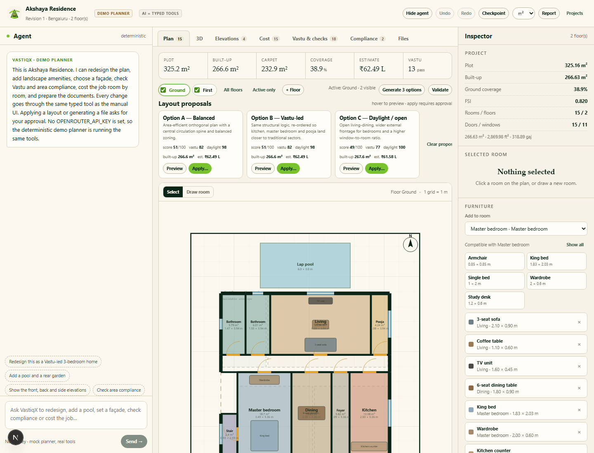
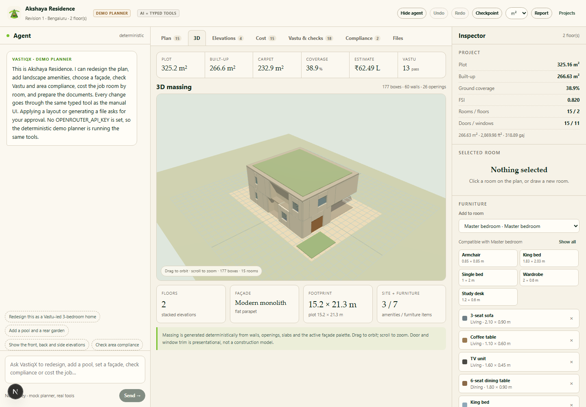
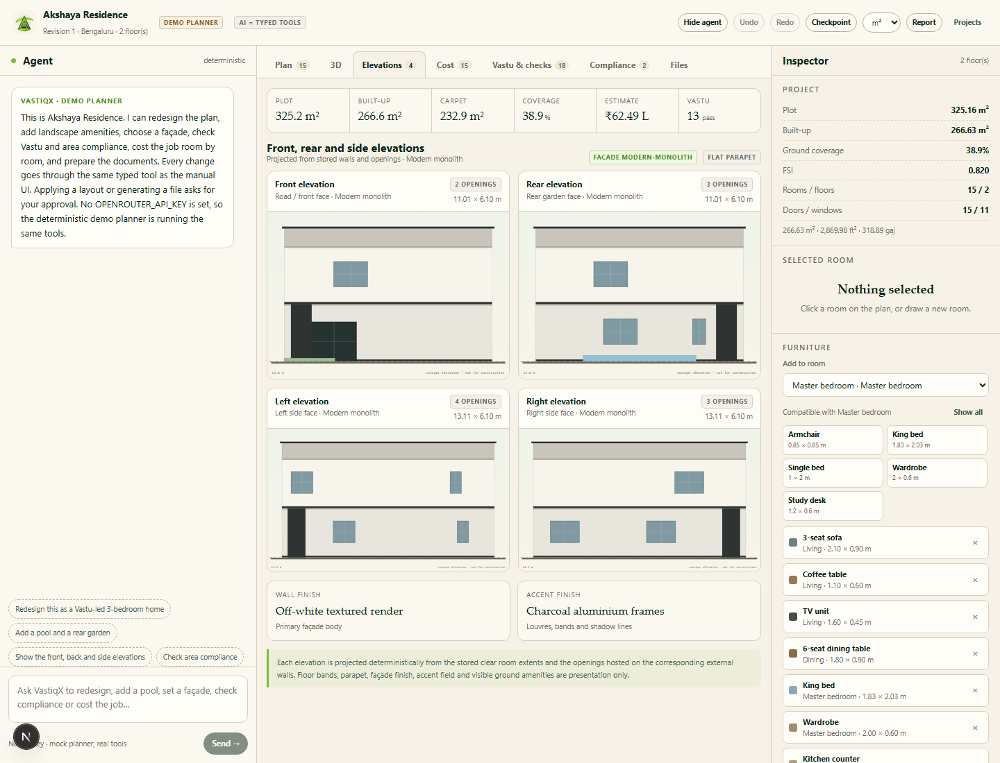
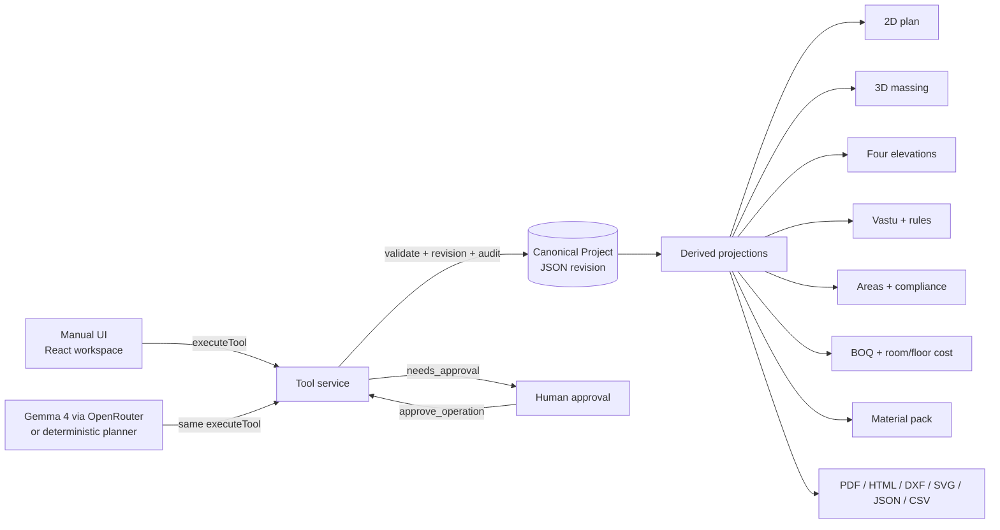

<div align="center">


# VastiqX

**Agentic architecture, Vastu, estimate and build planning.**  
From a plot and a brief to a traceable plan, modern elevations, room-wise cost and a downloadable report.

[](https://nextjs.org/)
[](https://www.typescriptlang.org/)
[](https://openrouter.ai/)
[](./LICENSE)

[Live workspace](https://vastiqx.vercel.app) · [Tool catalogue](https://vastiqx.vercel.app/api/tools) · [llms.txt](https://vastiqx.vercel.app/llms.txt) · [GitHub](https://github.com/inareshmatta/vastiqx)

</div>

<p align="center">
  
</p>

<p align="center">
  
  
</p>

---

## Why VastiqX

Most “AI floor plan” tools generate an image and leave you to guess whether the numbers are real. VastiqX takes the opposite approach.

> **The AI has no side door.** Every agent action is a validated call to the same typed domain tool the manual editor uses. The model cannot calculate, invent or persist geometry, areas, costs or reports directly.

That one rule makes the whole workspace auditable: the plan you see, the 3D massing, the four elevations, the Vastu findings, the area reconciliation, the cost breakdown and the PDF all project from **one canonical parametric model**.

---

## What you can do

| | |
|---|---|
| **Draw and design** | Plot, setbacks and north bearing; multi-floor rooms, walls, doors and windows; ghost-draw a room with exact live dimensions. |
| **Modern house styles** | Four modern façade families plus warm contemporary, coastal, brick, minimal grey, tropical and heritage looks. Front, rear, left and right concept elevations update from the same palette. |
| **See every floor** | Toggle floor visibility on and off. The active floor draws full room labels and dimensions; other selected floors overlay as light room outlines, so you can compare levels without losing context. |
| **Furnish rooms** | Add, move and remove beds, sofas, dining tables, wardrobes, kitchen counters, desks, bathroom fixtures and plants. Furniture is a presentation layer, deliberately excluded from areas, cost, Vastu and BOQ. |
| **Reconcile areas** | The sum of room clear areas must match the room union and built-up area. Wall/common share is surfaced, not hidden. See m², ft² and gaj together. |
| **Vastu and jurisdiction** | Versioned advisory packs with source-linked findings and an indicative Bengaluru demo pack. Missing inputs are `NOT ASSESSED`, never guessed. |
| **Cost it** | Room-wise, floor-wise and project cost; measured finish/service lines per room; shared structure, labour, overheads and GST allocated by clear room area and reconciled to the authoritative estimate total. |
| **Build quantities** | Bricks, cement bags, sand, aggregate, steel benchmark, tiles, paint and primer from the measured takeoff, with m³, ft³ and litre conversions. |
| **Download** | PDF report, self-contained HTML report, ASCII DXF, SVG plans, canonical JSON and CSV cost pack. Every export requires human approval. |
| **Let the agent work** | Gemma 4 via OpenRouter can redesign, add a pool, set a modern façade, furnish a bedroom, check compliance, cost the job and prepare documents — by calling the same tools. |

---

## Modern house styles

The design studio ships with nine façade templates, including four modern families:

- **Modern monolith** — off-white volumes, charcoal frames, full-height glazing, slim parapet.
- **Modern courtyard** — warm lime plaster, dark timber, planted terrace, deep shading.
- **Modern glass villa** — floating white slab, basalt base and structural glazing.
- **Minimal grey** — grey render, shadow lines, low visual noise.
- **Warm contemporary**, **coastal white**, **urban brick**, **tropical louvre**, **heritage jaali**.

The demo project is seeded with **Modern monolith**. Every façade style changes wall finish, accent finish, roof expression and the palette used by 3D and elevations — never the measured geometry.

Landscape templates: rear garden, courtyard garden, lap pool, timber deck, pergola, car driveway and roof terrace garden.

Furniture catalogue: 3-seat sofa, armchair, coffee table, TV unit, 6-seat dining table, dining chair, king/single bed, wardrobe, study desk, bookshelf, kitchen counter, fridge, washbasin, WC and indoor plant. Placement is deterministic and validated against the room polygon and existing furniture.

---

## Quick start

```bash
git clone https://github.com/inareshmatta/vastiqx.git
cd vastiqx
npm install
cp .env.example .env.local   # optional: add OPENROUTER_API_KEY
npm run dev
```

Open <http://localhost:3000>. The first request seeds a fully furnished modern demo project: 50 × 70 ft plot, two floors, three bedrooms, pool, rear garden, pergola, roof terrace and modern façade.

### Live Gemma 4

```env
OPENROUTER_API_KEY=sk-or-v1-...
OPENROUTER_MODEL=google/gemma-4-31b-it
```

The adapter uses the OpenRouter OpenAI-compatible endpoint with tool calling. Other supported IDs:

- `google/gemma-4-26b-a4b-it`
- `google/gemma-4-31b-it:free`
- `google/gemma-4-26b-a4b-it:free`

**No key?** The deterministic planner runs the same domain tools, so the full workflow is still inspectable. If a live provider call fails, the runtime says so and falls back instead of pretending.

---

## The tool contract

The manual UI and the agent share one function:

```ts
const envelope = await executeTool(projectId, call.name, call.arguments, {
  source: "agent",
  actorId: "vastiqx-agent",
  role: "editor",
  expectedVersion: revision,
  idempotencyKey,
});

// {
//   status: "succeeded" | "rejected" | "needs_approval" | "conflict" | "failed",
//   revision: 13,
//   result: { ... },
//   validation: { ok, findings, errors, warnings },
//   invalidated: ["areas", "3d", "elevations", "boq", "estimate"],
//   provenance: { source, actor_id, model_revision, calculated_at },
//   approval?: { approval_id, summary, affected, warnings }
// }
```

Release-blocking rules:

1. **No direct model writes.** The agent only receives tool definitions, never a database handle.
2. **Read before write.** Tools validate ids, geometry and revision.
3. **Optimistic concurrency.** Stale approvals are rejected instead of overwriting newer work.
4. **Approval is human-only.** Applying a layout, restoring a checkpoint, deleting a floor and every export require explicit approval.
5. **Truthful completion.** If a tool fails or needs approval, the agent must say so. It cannot claim a change was committed.
6. **Invalidation is explicit.** Each mutation reports which derived views are stale, and the UI refreshes from the server after success.

---

## Area compliance, honestly

- **Room clear area** — exact shoelace area of the stored clear polygon.
- **Built-up area** — deterministic 10 cm raster union of room polygons and wall footprints (±1%).
- **Carpet area** — sum of clear room polygons.
- **Room union** — raster union of room polygons, used to detect overlap/double counting.

For every floor:

```text
Σ room clear areas  ≈  room-polygon union       (tolerance max(0.15 m², 1%))
built-up area       ≥  Σ room clear areas
wall/common share   =  built-up − Σ room clear areas
```

If the room sum does not reconcile, the check **fails**; it is never silently normalised. Project totals are reconciled again from floor roll-ups. The UI shows the wall/common share as a percentage and every check includes its formula and variance.

### Units

| From | Equals |
|---|---|
| 1 m² | 10.7639 ft² · 1.19599 gaj · 0.000247105 acre |
| 1 ft² | 0.092903 m² · 0.111111 gaj |
| 1 gaj | 1 yd² · 0.836127 m² · 9 ft² |
| 1 m³ | 35.3147 ft³ · 1,000 litres |
| 1 bag cement | 50 kg |

The canonical model always stores metres. Display units are derived; they never mutate geometry.

---

## Cost methodology

Room direct lines are measured from room polygons and hosted openings, then priced with the active rate book and finish package factor. Structural work, common areas, labour, equipment, overheads, margin, GST and contingency are not directly attributable per room, so the remaining project estimate is allocated by clear room area.

The **project estimate total is authoritative**. Room and floor totals are an allocation view and are reconciled to it within ₹1. Every line carries a formula and a confidence label (`measured`, `benchmarked`, `assumed`).

The cost panel and report include:

- project totals, rate per built-up m² and planning band;
- floor roll-ups (direct + shared = total);
- room allocation and per-m² rate;
- measured finish/service lines for each room;
- inclusions, exclusions and missing inputs.

---

## Architecture



The file-backed store uses per-project locks, optimistic revisions and an append-only JSONL audit trail. Production would swap the store for a transactional database without changing the tool contract.

---

## Project structure

```text
src/
  domain/            canonical types, geometry, measure, layout, rules,
                     Vastu, BOQ, cost, units, calculator, templates,
                     elevations, compliance, furniture, 3D scene
  server/            store, service, derive, seed, export (SVG/PDF/HTML/DXF)
  tools/             typed domain tools + registry (same for UI and agent)
  agent/             OpenRouter adapter, deterministic planner, SSE runtime
  app/               landing, dashboard, workspace, API routes, SEO files
  components/        plan canvas, 3D viewer, elevations, cost, compliance,
                     furniture inspector, files, chat workspace
public/brand/        VastiqX logo and house mark
tests/               domain + service tests
```

### API

| Route | Purpose |
|---|---|
| `GET /api/projects` | Demo seed + project summaries + agent status |
| `POST /api/projects` | Create a project from plot and brief |
| `GET /api/projects/:id` | Full derived project view |
| `POST /api/projects/:id/tool` | Execute a typed tool (manual UI and scripts) |
| `POST /api/projects/:id/agent` | Streamed SSE agent loop |
| `GET /api/projects/:id/export/:file` | Download an approved artifact |
| `GET /api/tools` | Agent status + grouped tool catalogue |

---

## Exports

| File | Contents |
|---|---|
| PDF | Plans, area schedule, compliance checks, four elevations, room/floor cost, measured lines, material pack, Vastu/rules, estimate and assumptions |
| HTML | Self-contained printable report with embedded plans, elevations, cost, compliance, material pack, furniture and audit provenance |
| DXF | ASCII R12 layers for walls, rooms, openings and text in metres |
| SVG | Per-floor vector plans |
| JSON | Canonical model with schema version, revision and provenance |
| CSV | Room lines, floor roll-ups and project reconciliation |

All exports are generated deterministically on the server after approval. The agent cannot download or fabricate an artifact.

---

## Development

```bash
npm run typecheck
npm run test
npm run build
npm run dev
```

Environment:

| Variable | Default | Notes |
|---|---|---|
| `OPENROUTER_API_KEY` | unset | Enables live Gemma 4 tool calling |
| `OPENROUTER_MODEL` | `google/gemma-4-31b-it` | OpenRouter model id |
| `NEXT_PUBLIC_SITE_URL` | `https://vastiqx.vercel.app` | Metadata, sitemap, robots |
| `VASTIQX_DATA_DIR` | `.data` | File-backed demo store |

---

## Honest limits

VastiqX is **concept-stage planning software**. It is not a statutory submission, structural design, MEP design, BBS, valuation, construction certification or a quotation. Structural quantities are benchmarks until engineered. Vastu and jurisdiction outputs are advisory and source-labelled; local authority definitions of carpet, built-up and FSI may differ. Furniture, façade and landscape layers are presentation layers and are excluded from measured areas and cost. Pool/deck/roof structures and retaining/waterproofing require engineering.

---

## License

MIT © VastiqX. See [LICENSE](./LICENSE).

<div align="center">
  
  <p><strong>Design it. Check it. Cost it. Build it.</strong></p>
</div>
